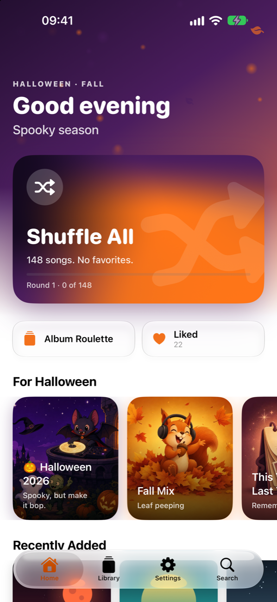
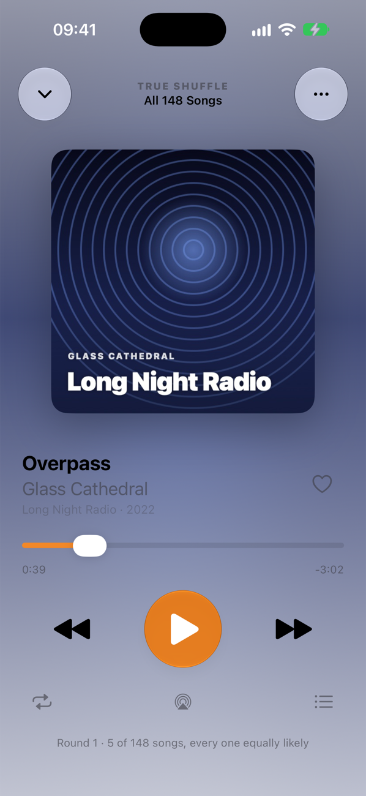

# Truffle

A music player for your Plex server, made for the car. Plex music, but sweeter.

**[Join the TestFlight beta →](https://testflight.apple.com/join/ZXeFFhZM)** Free, no in-app purchases.

> Bundle ID `com.vanities.truffle`. GPL-3.0. Website: https://am2.biz/truffle · [Support](https://am2.biz/truffle/support) · [Privacy](https://am2.biz/truffle/privacy)

<p align="center"> </p>

## What it does

- **Shuffle All, for real.** Every song once before any song twice, in a truly random order. No
  favorites: not your ratings, not your play counts, not what's popular.
- **A CarPlay screen with only the good buttons:** Shuffle All, Liked, the season's mixes, your
  playlists and your library. Now Playing gets one extra button, the heart.
- **Mixes that know what month it is.** Halloween, Thanksgiving, the holidays, New Year, Valentine's,
  and every season, built from your library's mood tags, plus This Time Last Year and your favorites
  from seasons past. The colors (and the little falling leaves) change with them.
- **Hand-picked seasonal mixes.** The `seasonal-mix` skill (`.claude/skills/seasonal-mix`) picks songs
  for a theme from your library, draws cover art from the picks, and saves "🎃 Halloween 2026" as a
  Plex playlist. Truffle plays it for that season's card.
- **Your files as they are,** FLAC included, straight from your server, at even volume from Plex's
  loudness analysis. It hops to your server's public address when you drive away from home Wi-Fi.
- Playlists, likes, artists, albums and search, all kept in Plex. Seasonal app icons, too.

## Building

```bash
brew install xcodegen
make gen && make test
make demo-library && make demo-server   # a stand-in Plex server with an invented library
make demo                                # run against it in the simulator
```

Device builds need a team: copy `Config/Signing.xcconfig.example` to `Config/Signing.xcconfig`.
`AGENTS.md` has the architecture, the Plex API notes and the release steps.
